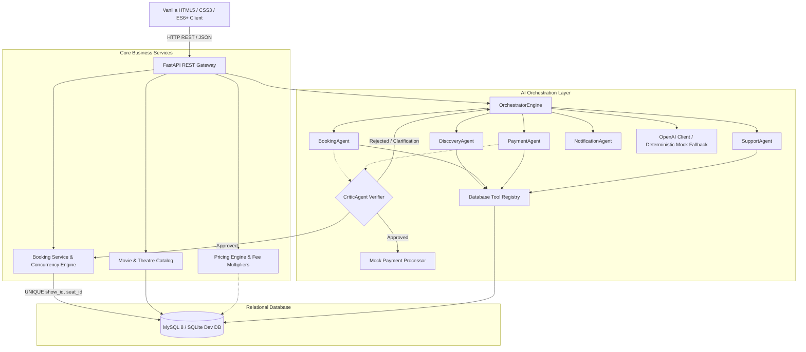
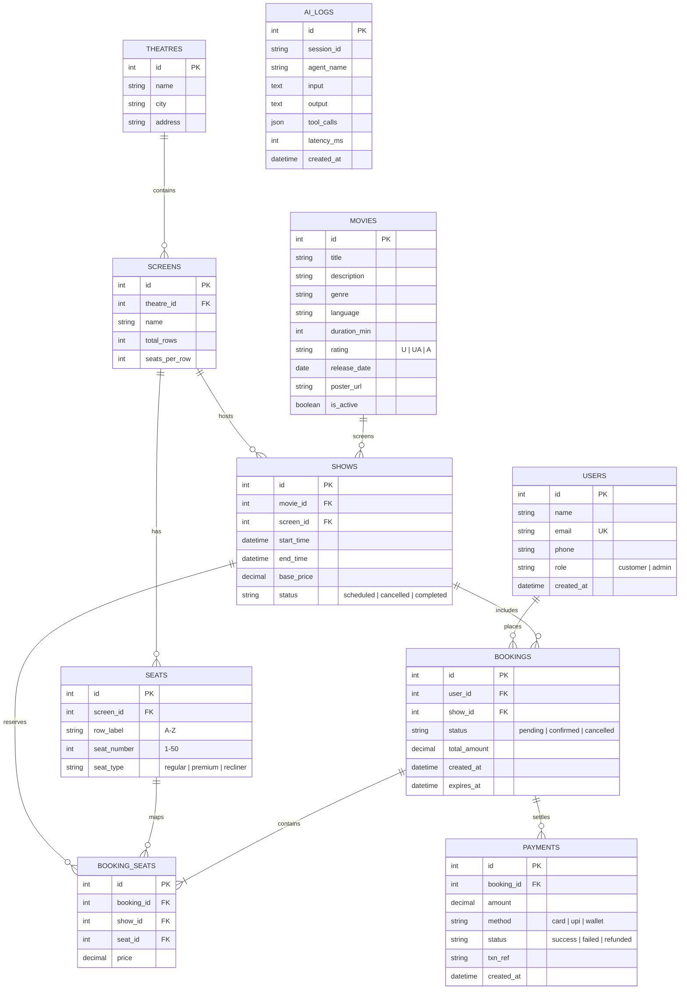
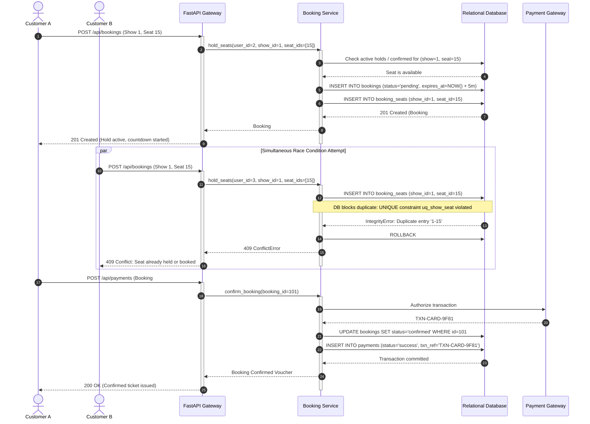
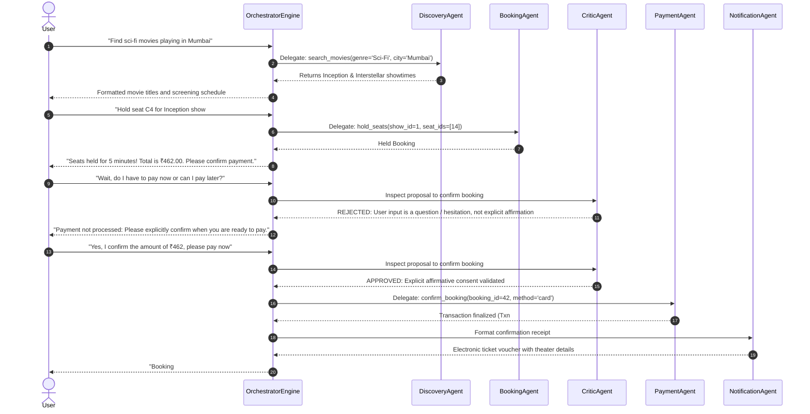

# Cineverse - Movie Ticket Booking System

### Classroom Case Study: Database + CRUD &rarr; Validation & Concurrency &rarr; GenAI &rarr; Single-Agent AI &rarr; Multi-Agent Orchestration

[](https://www.python.org/)
[](https://fastapi.tiangolo.com/)
[](https://www.sqlalchemy.org/)
[](https://docs.pydantic.dev/)
[](https://www.mysql.com/)
[](https://www.sqlite.org/)
[](https://docs.pytest.org/)
[](https://www.docker.com/)

Cineverse is an end-to-end, runnable reference application and curriculum demonstrating progressive software and AI engineering. Designed for classroom instruction, technical interviews, and production case studies, students and engineers build from foundational relational database concepts, atomic concurrency locking, and business rule enforcement up to single-agent tool loops and multi-agent hierarchical orchestration.

The project is completely self-contained, requiring **zero external API keys or cloud dependencies** to run locally. It features an automated offline deterministic mock planner for all AI capabilities, pre-seeded sample data, and an interactive cinematic dark-themed web frontend.

---

## Table of Contents

1. [Pedagogical Progression (The 7 Phases)](#pedagogical-progression-the-7-phases)
2. [Tech Stack & Architecture Rationale](#tech-stack--architecture-rationale)
3. [System Architecture Diagrams](#system-architecture-diagrams)
   - [System Topology](#system-topology)
   - [Entity-Relationship (ER) Diagram](#entity-relationship-er-diagram)
   - [Seat Reservation & Concurrency Flow](#seat-reservation--concurrency-flow)
   - [Multi-Agent Intent Routing & Critic Verification Flow](#multi-agent-intent-routing--critic-verification-flow)
4. [Database Schema & Data Model Deep Dive](#database-schema--data-model-deep-dive)
5. [Business Logic, Pricing & Concurrency Engine](#business-logic-pricing--concurrency-engine)
   - [Tiered Dynamic Pricing Formula](#tiered-dynamic-pricing-formula)
   - [Atomic Concurrency & 5-Minute Hold TTL](#atomic-concurrency--5-minute-hold-ttl)
   - [Tiered Cancellation & Refund Policy](#tiered-cancellation--refund-policy)
6. [AI Layer: Generative AI, Single-Agent & Multi-Agent](#ai-layer-generative-ai-single-agent--multi-agent)
   - [Phase 3: Direct Generative AI Completions](#phase-3-direct-generative-ai-completions)
   - [Phase 4: Single-Agent AI with Tools (ReAct Loop)](#phase-4-single-agent-ai-with-tools-react-loop)
   - [Security Guardrails & Prompt Defenses](#security-guardrails--prompt-defenses)
   - [Phase 5: Multi-Agent AI Orchestration (Least Privilege)](#phase-5-multi-agent-ai-orchestration-least-privilege)
   - [CriticAgent Verification Engine](#criticagent-verification-engine)
   - [Offline Deterministic Mock Fallback](#offline-deterministic-mock-fallback)
7. [Frontend Architecture & Visual Experience](#frontend-architecture--visual-experience)
8. [Setup & Running Locally](#setup--running-locally)
   - [Option 1: Instant Zero-Setup Run (Local SQLite)](#option-1-instant-zero-setup-run-local-sqlite)
   - [Option 2: Native Run with MySQL 8](#option-2-native-run-with-mysql-8)
   - [Option 3: Containerized Docker Compose](#option-3-containerized-docker-compose)
   - [Switching Between Mock Mode and Live LLM](#switching-between-mock-mode-and-live-llm)
9. [API Endpoint Reference & CLI Examples](#api-endpoint-reference--cli-examples)
10. [Automated Test Suite & Verification Report](#automated-test-suite--verification-report)
11. [Classroom Exercises & Stretch Goals](#classroom-exercises--stretch-goals)
12. [Documentation Index](#documentation-index)

---

## Pedagogical Progression (The 7 Phases)

The curriculum is structured into 7 progressive engineering milestones:

```
┌──────────────────────────────────────────────────────────────────────────────────┐
│  Phase 1: Relational Schema & REST CRUD (MySQL 8 / SQLAlchemy 2.0 / FastAPI)      │
└────────────────────────────────────────┬─────────────────────────────────────────┘
                                         ▼
┌──────────────────────────────────────────────────────────────────────────────────┐
│  Phase 2: Validation, Concurrency & Business Rules (Pydantic v2 / 5-Min TTL Holds)│
└────────────────────────────────────────┬─────────────────────────────────────────┘
                                         ▼
┌──────────────────────────────────────────────────────────────────────────────────┐
│  Phase 3: Generative AI Completions (OpenAI SDK / Structured JSON / Mock Fallback) │
└────────────────────────────────────────┬─────────────────────────────────────────┘
                                         ▼
┌──────────────────────────────────────────────────────────────────────────────────┐
│  Phase 4: Single-Agent AI with Tools (ReAct Loop / Guardrails / Audit Logging)    │
└────────────────────────────────────────┬─────────────────────────────────────────┘
                                         ▼
┌──────────────────────────────────────────────────────────────────────────────────┐
│  Phase 5: Multi-Agent AI Orchestration (Least Privilege / CriticAgent Verifier)   │
└────────────────────────────────────────┬─────────────────────────────────────────┘
                                         ▼
┌──────────────────────────────────────────────────────────────────────────────────┐
│  Phase 6: Frontend Experience (Vanilla HTML5 / CSS3 / ES6+ / Curved Seat Matrix)  │
└────────────────────────────────────────┬─────────────────────────────────────────┘
                                         ▼
┌──────────────────────────────────────────────────────────────────────────────────┐
│  Phase 7: Production Readiness (Pytest 76 Tests / Docker Compose / Swagger Docs)  │
└──────────────────────────────────────────────────────────────────────────────────┘
```

1. **Phase 1: Database & Core CRUD** &mdash; Normalized MySQL 8 schema ([sql/schema.sql](file:///c:/Users/mchan/OneDrive/Desktop/movie%20ticket%20booking%20system/sql/schema.sql)) with 10 tables, composite unique constraints, indexes, foreign keys with cascading rules, and declarative SQLAlchemy 2.0 models ([app/models.py](file:///c:/Users/mchan/OneDrive/Desktop/movie%20ticket%20booking%20system/app/models.py)). REST endpoints follow standard envelope error formats.
2. **Phase 2: Validation, Pricing & Concurrency Rules** &mdash; Strict Pydantic v2 schemas ([app/schemas.py](file:///c:/Users/mchan/OneDrive/Desktop/movie%20ticket%20booking%20system/app/schemas.py)) with phone regex validation and positive price guards. Concurrency engine enforces 5-minute atomic seat holds, composite unique locking preventing double-booking, and tiered cancellation refunds (>24h = 100%, 2–24h = 50%, <2h = 0%).
3. **Phase 3: Generative AI (Direct LLM Completions)** &mdash; Stateless AI completions for copywriting, catalog-aware recommendations, audience sentiment analysis, and booking confirmation emails with automatic structured JSON validation and error retries.
4. **Phase 4: Single-Agent AI with Tools** &mdash; Autonomous tool-calling ReAct loop (up to 6 iterations) executing database operations (`search_movies`, `get_showtimes`, `hold_seats`, `confirm_booking`). Guardrails intercept prompt injections, reject off-topic questions, and require explicit customer confirmation before executing state mutations.
5. **Phase 5: Multi-Agent AI Orchestration** &mdash; Hierarchical system dividing responsibilities under the principle of least privilege (`DiscoveryAgent`, `BookingAgent`, `PaymentAgent`, `SupportAgent`, `NotificationAgent`). Coordinated by `OrchestratorEngine` and validated by an authoritative `CriticAgent` verifier that vetoes unauthorized or ambiguous plans.
6. **Phase 6: Frontend Experience** &mdash; Cinematic dark theme built with vanilla HTML5, CSS3 custom properties, and modern JavaScript (ES6+). Zero build steps, zero npm dependencies. Features an interactive curved seat matrix, real-time 5-minute countdown timer, mock payment gateway, cancellation modal, and live agent execution traces.
7. **Phase 7: Production Readiness** &mdash; Comprehensive 76-test automated pytest suite, containerized Docker Compose deployment with MySQL 8 healthcheck polling, and complete OpenAPI/Swagger documentation.

---

## Tech Stack & Architecture Rationale

| Layer | Technology | Architectural Rationale |
|---|---|---|
| **Frontend** | Plain HTML5, Vanilla CSS3, Modern JavaScript (ES6+) | **Zero build step.** No Webpack, Vite, or React overhead. Static files are served directly by FastAPI under `/static`. Clean DOM manipulation, CSS grid/flexbox, custom properties, and XSS defense via `escapeHtml()`. |
| **Backend API Gateway** | Python 3.12, FastAPI, Pydantic v2 | High-performance asynchronous REST API framework with native OpenAPI/Swagger generation, strict data transfer validation, dependency injection, and centralized error envelopes. |
| **Database & ORM** | MySQL 8.0, PyMySQL, SQLAlchemy 2.0 ORM, SQLite | Enterprise relational schema with foreign key constraints, composite unique indexes (`UNIQUE(show_id, seat_id)`), row-level transactional locking. Seamless zero-setup local SQLite fallback (`cineverse_dev.db`) and in-memory test isolation. |
| **AI Layer** | OpenAI Python SDK (`openai>=1.0.0`) | Compatible with OpenAI `gpt-4o-mini`, Azure OpenAI, Ollama, vLLM, or LM Studio. Includes a deterministic rule-based offline mock planner when no API key is configured. |
| **Testing** | `pytest`, `httpx` TestClient, SQLite `QueuePool` | Zero-dependency local CI test suite executing 76 unit and integration tests in ~1.5 seconds. |
| **Containerization** | Docker, Docker Compose | Multi-container orchestration linking FastAPI service with a persistent MySQL 8 container and automated health checks. |

---

## System Architecture Diagrams

### System Topology



---

### Entity-Relationship (ER) Diagram



---

### Seat Reservation & Concurrency Flow

The sequence below illustrates atomic concurrency locking, hold timer enforcement, and race condition prevention:



---

### Multi-Agent Intent Routing & Critic Verification Flow



---

## Database Schema & Data Model Deep Dive

The database architecture features 10 normalized tables configured with composite constraints, foreign keys with referential actions, and indexed lookup fields:

| Table Name | Description | Key Constraints & Indexes |
|---|---|---|
| `users` | Customer profiles and administrative staff accounts. | `id` (PK), `email` (UK). Roles: `customer`, `admin`. |
| `movies` | Theatrical film catalog with runtime, language, and rating. | `id` (PK), `is_active` (INDEX). Ratings: `U`, `UA`, `A`. |
| `theatres` | Multiplex and cinema physical locations. | `id` (PK), `city` (INDEX). Located in Mumbai, Bengaluru, Delhi. |
| `screens` | Auditoriums inside a theatre. | `id` (PK), `theatre_id` (FK &rarr; `theatres.id` ON DELETE CASCADE). |
| `seats` | Physical seat grid layout within an auditorium screen. | `id` (PK), `screen_id` (FK &rarr; `screens.id`), `UNIQUE(screen_id, row_label, seat_number)`. |
| `shows` | Scheduled movie screenings at specific screens and times. | `id` (PK), `movie_id` (FK), `screen_id` (FK), `start_time` (INDEX). |
| `bookings` | Ticket reservations with lifecycle status and hold TTL. | `id` (PK), `user_id` (FK), `show_id` (FK), `status` (INDEX), `expires_at` (INDEX). |
| `booking_seats` | Join table mapping reserved seats to bookings. | `id` (PK), `booking_id` (FK), `seat_id` (FK), `UNIQUE uq_show_seat (show_id, seat_id)`. |
| `payments` | Financial settlement records and mock gateway references. | `id` (PK), `booking_id` (FK &rarr; `bookings.id`), `txn_ref` (UK). |
| `ai_logs` | Audit trail recording all single-agent and multi-agent operations. | `id` (PK), `session_id` (INDEX), `latency_ms`, `created_at`. |

### Seed Data Inventory

Running the seeder ([app/services/seed.py](file:///c:/Users/mchan/OneDrive/Desktop/movie%20ticket%20booking%20system/app/services/seed.py) or `sql/seed.sql`) populates:
- **3 Users**: 1 Administrator (`admin@cineverse.com`), 2 Customers (`aarav.sharma@example.com`, `diya.patel@example.com`).
- **8 Feature Films**: *Inception*, *Interstellar*, *Dune: Part Two*, *The Dark Knight*, *Oppenheimer*, *Spider-Man: Across the Spider-Verse*, *RRR*, and *Spirited Away*.
- **3 Prime Multiplexes**: PVR ICON Phoenix Palladium (Mumbai), INOX Megaplex Nexus Koramangala (Bengaluru), Cinepolis DLF Avenue Saket (Delhi).
- **6 Screens**: 2 screens per theatre (IMAX Laser, Dolby Atmos, 4DX Experience, Insignia Lounge, Macro XE, Onyx LED).
- **240 Physical Seats**: 40 seats per screen (Rows A & B: Regular 1.0x, Row C: Premium 1.4x, Row D: Recliner 1.8x).
- **35 Scheduled Shows**: 5 daily shows per day spanning the upcoming 7 days, dynamically anchored relative to current runtime.

---

## Business Logic, Pricing & Concurrency Engine

### Tiered Dynamic Pricing Formula

Ticket pricing is calculated centrally in [app/services/pricing.py](file:///c:/Users/mchan/OneDrive/Desktop/movie%20ticket%20booking%20system/app/services/pricing.py) using the following formula:

$$\text{Seat Price} = \text{Base Price} \times \text{Tier Multiplier} \times (1 + \text{Weekend Surcharge})$$

$$\text{Subtotal} = \sum \text{Seat Prices}$$

$$\text{Convenience Fee} = \text{Subtotal} \times 0.02$$

$$\text{Total Amount} = \text{round}(\text{Subtotal} + \text{Convenience Fee}, 2)$$

- **Seat Multipliers**:
  - `regular` (Rows A & B): **1.0x** base price.
  - `premium` (Row C): **1.4x** base price.
  - `recliner` (Row D): **1.8x** base price.
- **Weekend Surcharge**: **10% (0.10)** applied if the show is scheduled on Friday, Saturday, or Sunday.
- **Convenience Fee**: **2% (0.02)** applied to the total ticket subtotal.

---

### Atomic Concurrency & 5-Minute Hold TTL

Cineverse implements a defense-in-depth concurrency model to prevent double-booking:

1. **Pre-check Query**: Before placing a hold, the booking service inspects whether any requested seat is actively held (`status = 'pending' AND expires_at > NOW()`) or confirmed (`status = 'confirmed'`).
2. **Relational Composite Unique Constraint**: The `booking_seats` table enforces:
   ```sql
   UNIQUE KEY uq_show_seat (show_id, seat_id)
   ```
   If two requests pass the pre-check simultaneously, the database engine permits exactly one write to succeed. The second write raises an `IntegrityError` or `FlushError`, which is trapped and returned to the client as an HTTP `409 ConflictError`.
3. **5-Attempt Bounded Retry with Exponential Backoff**: Transient database lock contentions (MySQL error 1205/1213 or SQLite busy locks) are automatically retried up to 5 times with exponential backoff before bubbling up.
4. **Lazy & Startup TTL Expiry**: Expired holds (`expires_at < NOW()`) are cleared automatically whenever seat maps are queried, when new holds are attempted, and during application startup.

---

### Tiered Cancellation & Refund Policy

Implemented in [app/services/booking_service.py](file:///c:/Users/mchan/OneDrive/Desktop/movie%20ticket%20booking%20system/app/services/booking_service.py):

$$\Delta T = \text{Show Start Time} - \text{Cancellation Time}$$

| Cancellation Window ($\Delta T$) | Refund Percentage | Convenience Fee Refunded? | Booking Status |
|---|---|---|---|
| **$\Delta T > 24$ hours** | **100% Refund** | No (Convenience fee is retained) | `CANCELLED` (Seats released) |
| **$2 \le \Delta T \le 24$ hours** | **50% Refund** | No | `CANCELLED` (Seats released) |
| **$\Delta T < 2$ hours** | **0% (Disallowed)** | No | Rejection with `400 Bad Request` |

---

## AI Layer: Generative AI, Single-Agent & Multi-Agent

### Phase 3: Direct Generative AI Completions

Located in [app/ai/genai_features.py](file:///c:/Users/mchan/OneDrive/Desktop/movie%20ticket%20booking%20system/app/ai/genai_features.py), exposing 4 specialized endpoints under `/api/ai/genai`:
- **`/movie-summary`**: Generates a tone-tailored (exciting, poetic, dramatic, family-friendly) spoiler-free marketing synopsis.
- **`/recommend`**: Mood-based recommender injecting active catalog movies into prompt context and parsing structured JSON with 3 ranked matches and percentage match scores.
- **`/review-summarize`**: Audience feedback summarizer extracting overall sentiment (`positive`, `mixed`, `negative`), concise summary, key pros, and key cons.
- **`/booking-email`**: Personalized confirmation email generator with venue directions and booking voucher details.

---

### Phase 4: Single-Agent AI with Tools (ReAct Loop)

Implemented in [app/ai/single_agent.py](file:///c:/Users/mchan/OneDrive/Desktop/movie%20ticket%20booking%20system/app/ai/single_agent.py):
- **Autonomous Tool-Calling Loop**: Coordinates with OpenAI function-calling schemas up to a maximum reasoning limit of **6 iterations** (`MAX_ITERATIONS = 6`).
- **Tool Registry**:
  - `search_movies(query, genre, language)`
  - `get_showtimes(movie_id, date, city)`
  - `get_available_seats(show_id, seat_type, count)`
  - `calculate_price(show_id, seat_ids)`
  - `hold_seats(user_id, show_id, seat_ids)`
  - `confirm_booking(booking_id, payment_method)`
  - `cancel_booking(booking_id, user_id)`
  - `get_my_bookings(user_id)`
- **Audit Trail**: Every tool invocation and conversational turn is recorded in the `ai_logs` table with latency timing in milliseconds.

---

### Security Guardrails & Prompt Defenses

Implemented in [app/ai/guardrails.py](file:///c:/Users/mchan/OneDrive/Desktop/movie%20ticket%20booking%20system/app/ai/guardrails.py):

1. **Rate Limiting**: In-memory sliding-window limiter enforcing a maximum of **20 requests per minute** per session ID. Violations return `429 Too Many Requests`.
2. **Prompt Injection Detection**: Regex-based heuristic filters scanning for instruction overrides, system prompt extraction, and prompt jailbreaks (e.g. `ignore previous instructions`, `dan mode`, `jailbreak`, `act as a linux terminal`). Violations return `422 Validation Error`.
3. **Off-Topic Refusal**: Intercepts requests regarding financial advice, medical consultation, programming/coding assistance, or legal advice, returning a polite boundary refusal message.
4. **Explicit Confirmation Guardrail**: Strictly prohibits calling `confirm_booking` or `cancel_booking` unless:
   - The assistant has recently presented a price or booking summary.
   - The user's reply affirmatively matches approval patterns (`ok`, `yep`, `proceed`, `confirm`, `sounds good`).
   - The user's reply contains no negations, hesitations, or questions (`don't pay yet`, `yes but wait`, `how do I pay?`).

---

### Phase 5: Multi-Agent AI Orchestration (Least Privilege)

Implemented in [app/ai/multi_agent.py](file:///c:/Users/mchan/OneDrive/Desktop/movie%20ticket%20booking%20system/app/ai/multi_agent.py), splitting capabilities into narrow specialist agents under the **principle of least privilege**:

| Agent Name | Specialization Domain | Allowed Tools |
|---|---|---|
| **`OrchestratorEngine`** | Intent classification, session state coordination, and execution trace aggregation. | None (Coordinates other agents) |
| **`DiscoveryAgent`** | Film catalog browsing, genre filtering, and showtime schedules. | `search_movies`, `get_showtimes` |
| **`BookingAgent`** | Auditorium seat inspection, price calculation, and 5-minute atomic seat holds. | `get_available_seats`, `calculate_price`, `hold_seats` |
| **`PaymentAgent`** | Transaction settlement and booking status confirmation. | `confirm_booking` |
| **`SupportAgent`** | Cancellation processing, refund tier calculation, and booking history retrieval. | `cancel_booking`, `get_my_bookings` |
| **`NotificationAgent`**| Formats structured booking confirmation and cancellation vouchers. | None (Template generation) |
| **`CriticAgent`** | Authoritative pre-execution verifier inspecting proposed state mutations. | None (Veto authority over state changes) |

---

### CriticAgent Verification Engine

Prior to any execution of `PaymentAgent` or `SupportAgent`, the proposed action is routed to the `CriticAgent`:
- **Hold Validation**: Confirms that seats are currently held and that the hold has not expired.
- **Price Verification**: Checks that the payment amount matches the calculated total amount.
- **Explicit Consent**: Validates that the customer explicitly confirmed the exact amount and seats without hesitation or pending questions.
- **Rejection with Actionable Feedback**: If verification fails, the CriticAgent rejects the plan with detailed guidance (e.g., *"CriticAgent verification rejected: Payment requires explicit user confirmation. Please confirm that you want to pay ₹462.00 for Booking #42"*).

---

### Offline Deterministic Mock Fallback

When `LLM_API_KEY` is empty or set to `mock`, all AI endpoints execute against an internal deterministic rule-based planner:
- All responses return `"mock": true` in their JSON envelopes.
- Enables complete, offline classroom testing with zero costs and zero external dependencies.

---

## Frontend Architecture & Visual Experience

The frontend is implemented with vanilla HTML5, CSS3, and ES6+ JavaScript:
- **No Bundlers / No Build Steps**: Static files are located in `/frontend` and mounted directly by FastAPI.
- **Cinematic Dark Theme Design System**: [frontend/css/styles.css](file:///c:/Users/mchan/OneDrive/Desktop/movie%20ticket%20booking%20system/frontend/css/styles.css) uses CSS custom properties (`--bg-primary`, `--accent-gold`, `--accent-cyan`, `--accent-green`, `--accent-red`).
- **Interactive Curved Seat Matrix**: [frontend/seats.html](file:///c:/Users/mchan/OneDrive/Desktop/movie%20ticket%20booking%20system/frontend/seats.html) renders alphabetical rows, visual curve curvature, real-time pricing recalculations, and an active 5-minute countdown banner.
- **Demo User Switcher**: Top-right navigation dropdown seamlessly toggles between Customer (`Aarav Sharma`), Customer (`Diya Patel`), and Staff (`Admin Cineverse`), attaching the `X-User-Id` HTTP header to all API requests.
- **AI Concierge Interface**: [frontend/assistant.html](file:///c:/Users/mchan/OneDrive/Desktop/movie%20ticket%20booking%20system/frontend/assistant.html) features a 3-way toggle (GenAI features, Single Agent tool loop, Multi-Agent Orchestrator) with real-time collapsible execution traces and CriticAgent feedback badges.
- **Operations Admin Portal**: [frontend/admin.html](file:///c:/Users/mchan/OneDrive/Desktop/movie%20ticket%20booking%20system/frontend/admin.html) provides movie CRUD, screen show scheduling with overlap conflict prevention, and revenue metrics.

---

## Setup & Running Locally

### Option 1: Instant Zero-Setup Run (Local SQLite)

The repository includes a ready-to-use SQLite database (`cineverse_dev.db`) pre-seeded with 8 movies, 6 screens, 240 seats, and 35 upcoming shows.

#### 1. Prerequisites
- Python 3.11+

#### 2. Create and Activate Virtual Environment
```bash
# Clone the repository
git clone <repo-url>
cd "movie ticket booking system"

# Create virtual environment
python -m venv venv

# On Windows:
venv\Scripts\activate
# On Linux/macOS:
source venv/bin/activate

# Install dependencies
pip install -r requirements.txt
```

#### 3. Start the Server
```bash
uvicorn app.main:app --host 0.0.0.0 --port 8000 --reload
```

#### 4. Access the Application
- **Web UI**: [http://localhost:8000](http://localhost:8000)
- **Interactive Swagger Docs**: [http://localhost:8000/docs](http://localhost:8000/docs)
- **Alternative ReDoc**: [http://localhost:8000/redoc](http://localhost:8000/redoc)
- **Health Check Probe**: [http://localhost:8000/health](http://localhost:8000/health)

---

### Option 2: Native Run with MySQL 8

#### 1. Configure Environment Variables
Edit your `.env` file (copied from `.env.example`):
```env
APP_ENV=development
PORT=8000
SECRET_KEY=cineverse-super-secret-development-key-change-in-prod

# Comment out DATABASE_URL to switch to MySQL:
# DATABASE_URL=sqlite:///./cineverse_dev.db

DB_HOST=localhost
DB_PORT=3306
DB_NAME=movie_ticket_booking
DB_USER=cineverse
DB_PASSWORD=cineverse_secret

# Leave empty for offline deterministic mock mode
LLM_API_KEY=
LLM_BASE_URL=https://api.openai.com/v1
LLM_MODEL=gpt-4o-mini
```

#### 2. Initialize and Seed MySQL Database
Ensure MySQL is running, then run the database seeder:
```bash
python -m app.services.seed
```

#### 3. Start Application
```bash
uvicorn app.main:app --host 0.0.0.0 --port 8000 --reload
```

---

### Option 3: Containerized Docker Compose

Run the complete multi-container setup (FastAPI web service + MySQL 8 container with automatic schema and seed initialization):

```bash
docker compose up --build
```

Access the application at [http://localhost:8000](http://localhost:8000).

---

### Switching Between Mock Mode and Live LLM

- **Offline Mock Mode (Default)**:
  When `LLM_API_KEY` is empty, unset, or set to `mock`, all AI endpoints operate deterministically without calling external APIs. Responses include `"mock": true`.
- **Live LLM Mode**:
  Provide an active OpenAI-compatible API key in `.env`:
  ```env
  LLM_API_KEY=sk-proj-your-api-key-here
  LLM_BASE_URL=https://api.openai.com/v1
  LLM_MODEL=gpt-4o-mini
  ```
  Responses will now be generated dynamically by the target model with `"mock": false`.

---

## API Endpoint Reference & CLI Examples

### System & Health

| Method | Endpoint | Description |
|---|---|---|
| `GET` | `/health` | System health check and database connectivity probe |

```bash
curl -X GET "http://localhost:8000/health"
```

---

### Movie Catalog

| Method | Endpoint | Description |
|---|---|---|
| `GET` | `/api/movies` | List movies with pagination, search query, genre/language filter |
| `GET` | `/api/movies/{id}` | Retrieve individual movie details by ID |
| `POST` | `/api/movies` | Register a new film listing (Requires Admin: `X-User-Id: 1`) |
| `PUT` | `/api/movies/{id}` | Update movie metadata (Requires Admin) |
| `DELETE`| `/api/movies/{id}` | Deactivate / archive a movie listing (Requires Admin) |

```bash
# Query active Sci-Fi movies
curl -X GET "http://localhost:8000/api/movies?genre=Sci-Fi&page=1&page_size=5"

# Add movie listing as administrator
curl -X POST "http://localhost:8000/api/movies" \
  -H "Content-Type: application/json" \
  -H "X-User-Id: 1" \
  -d '{
    "title": "Avatar: The Way of Water",
    "description": "Jake Sully lives with his newfound family formed on the extrasolar moon Pandora.",
    "genre": "Sci-Fi",
    "language": "English",
    "duration_min": 192,
    "rating": "UA",
    "release_date": "2022-12-16T00:00:00",
    "poster_url": "https://example.com/avatar.jpg"
  }'
```

---

### Multiplex Theatres, Screens & Shows

| Method | Endpoint | Description |
|---|---|---|
| `GET` | `/api/theatres` | List theatres with city filter and nested screen arrays |
| `GET` | `/api/theatres/{id}` | Retrieve individual theatre by ID |
| `POST` | `/api/theatres` | Register a new theatre location |
| `GET` | `/api/screens/{id}` | Retrieve auditorium screen details |
| `GET` | `/api/screens/{id}/seats`| Retrieve all physical seats in an auditorium |
| `POST` | `/api/screens` | Create screen and generate physical seat grid |
| `GET` | `/api/shows` | Query scheduled shows filtered by movie, date, city |
| `GET` | `/api/shows/{id}` | Retrieve show details including movie and screen |
| `POST` | `/api/shows` | Schedule a show with overlap conflict validation (Requires Admin) |
| `GET` | `/api/shows/{id}/seats` | Real-time seat layout map with availability and prices |

```bash
# Inspect real-time seat map for Show 1
curl -X GET "http://localhost:8000/api/shows/1/seats"

# Schedule a screening as administrator
curl -X POST "http://localhost:8000/api/shows" \
  -H "Content-Type: application/json" \
  -H "X-User-Id: 1" \
  -d '{
    "movie_id": 1,
    "screen_id": 1,
    "start_time": "2026-10-25T18:00:00",
    "end_time": "2026-10-25T20:45:00",
    "base_price": 320.00
  }'
```

---

### Bookings & Checkout Payments

| Method | Endpoint | Description |
|---|---|---|
| `POST` | `/api/bookings` | Hold up to 6 seats with a 5-minute atomic TTL |
| `GET` | `/api/bookings/{id}` | Retrieve booking voucher details |
| `POST` | `/api/payments` | Authorize payment and confirm held booking |
| `POST` | `/api/bookings/{id}/cancel` | Cancel booking and calculate refund according to policy |
| `GET` | `/api/users/{id}/bookings` | Retrieve user reservation history |

```bash
# 1. Hold seats (Customer user_id = 2)
curl -X POST "http://localhost:8000/api/bookings" \
  -H "Content-Type: application/json" \
  -d '{"user_id": 2, "show_id": 1, "seat_ids": [41, 42]}'

# 2. Confirm booking via payment
curl -X POST "http://localhost:8000/api/payments" \
  -H "Content-Type: application/json" \
  -d '{"booking_id": 1, "method": "card"}'

# 3. Cancel booking with tiered refund
curl -X POST "http://localhost:8000/api/bookings/1/cancel" \
  -H "X-User-Id: 2"
```

---

### AI Endpoints (GenAI, Single-Agent, Multi-Agent)

| Method | Endpoint | Description |
|---|---|---|
| `POST` | `/api/ai/genai/movie-summary` | Generate marketing blurb in a specified tone |
| `POST` | `/api/ai/genai/recommend` | Mood-based 3-movie recommendation engine |
| `POST` | `/api/ai/genai/review-summarize` | Summarize reviews into overall sentiment, pros, and cons |
| `POST` | `/api/ai/genai/booking-email` | Generate personalized confirmation email text |
| `POST` | `/api/ai/agent/chat` | Single-agent ReAct tool-calling loop (max 6 iterations) |
| `POST` | `/api/ai/multi/chat` | Multi-agent orchestrated execution with CriticAgent verification |
| `GET` | `/api/ai/multi/trace/{session_id}` | Retrieve chronological step execution traces for a session |

```bash
# Chat with Multi-Agent Orchestrator
curl -X POST "http://localhost:8000/api/ai/multi/chat" \
  -H "Content-Type: application/json" \
  -d '{
    "session_id": "demo-sess-1",
    "user_id": 2,
    "message": "What movies are playing tomorrow?"
  }'

# Inspect Multi-Agent trace
curl -X GET "http://localhost:8000/api/ai/multi/trace/demo-sess-1"
```

---

## Automated Test Suite & Verification Report

The test suite consists of **13 test modules** and **76 automated tests** using `pytest` and `httpx` TestClient:

```bash
pytest -v
```

### Test Module Breakdown

| Module | Test Count | Scope Covered |
|---|---|---|
| `test_ai.py` | 6 tests | GenAI endpoints: movie summary, 404 handling, mood recommendations, review sentiment analysis, empty review 422 error, booking confirmation email. |
| `test_ai_llm_path.py` | 4 tests | Simulated LLM function-calling execution with MagicMock, invalid JSON recovery, iteration limit enforcement, and structured retry mechanisms. |
| `test_api_contracts.py` | 5 tests | Strict contract parity between frontend JavaScript fetch payloads and backend router schemas across all 5 views. |
| `test_booking.py` | 6 tests | Seat map queries, hold & payment confirmation flow, 5-minute expiry releasing seats, cancellation refund tiers (100%, 50%, disallowed <2h), and cross-user authorization guards. |
| `test_concurrency.py` | 3 tests | Multi-threaded race conditions (2 threads and 10 threads competing for the exact same seat), proving database unique constraint enforcement. |
| `test_frontend.py` | 2 tests | Verification that all HTML pages and static CSS/JS files serve HTTP 200 OK. |
| `test_movies.py` | 10 tests | Movie catalog pagination, genre filtering, language filtering, title search, ID lookup, 404 formatting, admin creation, RBAC rejection, update, and deletion. |
| `test_multi_agent.py` | 8 tests | Multi-agent routing across Discovery, Booking, Payment, Support, Notification, trace extraction, and CriticAgent verifier rejection/approval logic. |
| `test_pricing.py` | 5 tests | Seat tier multipliers (1.0x, 1.4x, 1.8x), weekend detection (Fri/Sat/Sun), weekday pricing, weekend 10% surcharge, and 2% convenience fee calculation. |
| `test_schema_parity.py` | 1 test | Direct validation asserting complete schema and constraint parity between `sql/schema.sql` DDL and `app/models.py` ORM models. |
| `test_shows.py` | 7 tests | Multiplex listing, show filtering, screen conflict collision detection, admin authorization checks, nested screens in theatre listings, and system `/health` probe. |
| `test_single_agent.py` | 6 tests | Autonomous ReAct tool execution, prompt injection defense, off-topic refusal, confirmation guardrail (negations vs affirmations), and complete end-to-end booking journey. |
| `test_users_screens.py` | 3 tests | User registration, unique email duplicate 409 conflict, and automatic screen physical seat layout generation. |

---

## Classroom Exercises & Stretch Goals

### Classroom Exercises

1. **Exercise 1: Dynamic Pricing & Seat Multipliers**
   - *Goal*: Extend [app/services/pricing.py](file:///c:/Users/mchan/OneDrive/Desktop/movie%20ticket%20booking%20system/app/services/pricing.py) to add a student discount tier (15% off base price for users with an email ending in `.edu`).
   - *Hint*: Add an `is_student: bool` check in `calculate_seat_price` and write a unit test in `tests/test_pricing.py`.

2. **Exercise 2: Real-Time Seat Release Background Task**
   - *Goal*: Implement an asynchronous FastAPI lifespan worker task in [app/main.py](file:///c:/Users/mchan/OneDrive/Desktop/movie%20ticket%20booking%20system/app/main.py) that invokes `release_expired_holds(db)` every 30 seconds automatically.
   - *Hint*: Use `asyncio.sleep(30)` inside an asynchronous lifespan background loop.

3. **Exercise 3: Support Agent VIP Policy Extension**
   - *Goal*: Add a VIP loyalty policy where customers with more than 3 confirmed bookings are granted 100% refund up to 1 hour before showtime.
   - *Hint*: Update `CINEMA_POLICY_TEXT` in [app/ai/prompts.py](file:///c:/Users/mchan/OneDrive/Desktop/movie%20ticket%20booking%20system/app/ai/prompts.py) and modify `cancel_booking` in [app/services/booking_service.py](file:///c:/Users/mchan/OneDrive/Desktop/movie%20ticket%20booking%20system/app/services/booking_service.py).

4. **Exercise 4: CriticAgent Night Show Seat Restriction**
   - *Goal*: Expand `CriticAgent.evaluate` in [app/ai/multi_agent.py](file:///c:/Users/mchan/OneDrive/Desktop/movie%20ticket%20booking%20system/app/ai/multi_agent.py) to reject seat holds exceeding 4 tickets for shows starting after 9:00 PM.
   - *Hint*: Inspect `show.start_time.hour` during hold plan evaluation.

5. **Exercise 5: Add a Concessions & Snack Upsell Agent**
   - *Goal*: Create a `ConcessionAgent` in [app/ai/multi_agent.py](file:///c:/Users/mchan/OneDrive/Desktop/movie%20ticket%20booking%20system/app/ai/multi_agent.py) with tools `list_combos()` and `add_concessions_to_booking()`.
   - *Hint*: Add a `concessions` table in `sql/schema.sql` and wire the agent into `OrchestratorEngine` intent routing.

### Stretch Goals

- **RAG Over Movie Reviews**: Ingest audience reviews into ChromaDB / pgvector and enable the `DiscoveryAgent` to answer semantic questions like *"Is this film suitable for a 10-year-old child?"*
- **Streaming AI Responses**: Implement Server-Sent Events (SSE) with FastAPI `StreamingResponse` for live token streaming in the assistant chat UI.
- **Cryptographic JWT Authentication**: Replace client-supplied demo user IDs with OAuth2 password/bearer flow, password hashing via `passlib` + `bcrypt`, and role-based access control (RBAC) dependencies checking `UserRole.ADMIN`.

---

## Documentation Index

The `/docs` directory serves as the project's single source of truth:

- [docs/PROJECT_CONTEXT.md](file:///c:/Users/mchan/OneDrive/Desktop/movie%20ticket%20booking%20system/docs/PROJECT_CONTEXT.md) &mdash; Project overview, tech stack, and non-negotiable architectural rules.
- [docs/PLAN.md](file:///c:/Users/mchan/OneDrive/Desktop/movie%20ticket%20booking%20system/docs/PLAN.md) &mdash; Granular task checklist across all 7 implementation phases.
- [docs/DECISIONS.md](file:///c:/Users/mchan/OneDrive/Desktop/movie%20ticket%20booking%20system/docs/DECISIONS.md) &mdash; Architectural Decision Records (ADR-001 through ADR-006).
- [docs/ARCHITECTURE.md](file:///c:/Users/mchan/OneDrive/Desktop/movie%20ticket%20booking%20system/docs/ARCHITECTURE.md) &mdash; Component diagrams, request flows, and multi-agent topology.
- [docs/API.md](file:///c:/Users/mchan/OneDrive/Desktop/movie%20ticket%20booking%20system/docs/API.md) &mdash; Complete REST API endpoint reference with curl examples.
- [docs/AI_DESIGN.md](file:///c:/Users/mchan/OneDrive/Desktop/movie%20ticket%20booking%20system/docs/AI_DESIGN.md) &mdash; Tool schemas, agent privileges, and security guardrail specifications.
- [docs/PROGRESS_LOG.md](file:///c:/Users/mchan/OneDrive/Desktop/movie%20ticket%20booking%20system/docs/PROGRESS_LOG.md) &mdash; Audit log with verification commands and phase outcomes.
- [docs/KNOWN_ISSUES.md](file:///c:/Users/mchan/OneDrive/Desktop/movie%20ticket%20booking%20system/docs/KNOWN_ISSUES.md) &mdash; Known limitations, architectural trade-offs, and future roadmap items.
