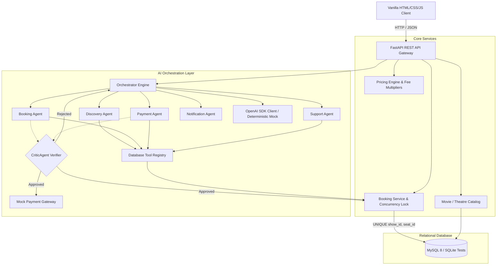
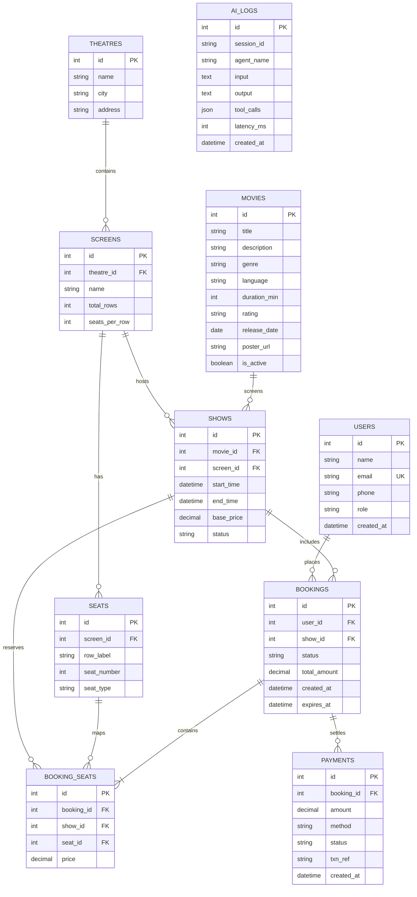

# Cineverse - Movie Ticket Booking System
### Classroom Case Study: Database + CRUD &rarr; Validation &rarr; GenAI &rarr; Single-Agent AI &rarr; Multi-Agent Orchestration

Cineverse is an end-to-end, runnable reference application and teaching curriculum demonstrating progressive software and AI engineering. Students build from foundational relational database concepts, atomic concurrency locking, and business rule enforcement up to single-agent tool loops and multi-agent hierarchical orchestration.

---

## Pedagogical Progression

1. **Phase 1: Database & CRUD** &mdash; MySQL 8 relational schema with foreign key constraints, indexes, unique keys, and FastAPI REST endpoints.
2. **Phase 2: Validation & Business Rules** &mdash; Strict Pydantic v2 schemas, transactional concurrency safety preventing double-booking, 5-minute atomic seat holds, and tiered cancellation refund rules.
3. **Phase 3: Generative AI** &mdash; Direct LLM completions with structured JSON outputs, input sanitization, error retries, and offline deterministic fallback.
4. **Phase 4: Single-Agent AI with Tools** &mdash; Autonomous tool-calling ReAct loop (up to 6 turns), prompt injection guardrails, domain boundary defense, and audit logging.
5. **Phase 5: Multi-Agent AI Orchestration** &mdash; Domain specialization under the principle of least privilege (`DiscoveryAgent`, `BookingAgent`, `PaymentAgent`, `SupportAgent`, `NotificationAgent`) coordinated by an `OrchestratorEngine` and validated by an authoritative `CriticAgent` verifier.
6. **Phase 6: Frontend Experience** &mdash; Cinematic dark theme with vanilla HTML5, CSS3, and JavaScript, interactive curved seat matrix, real-time 5-minute hold timer, and live agent execution traces.
7. **Phase 7: Production Readiness** &mdash; Pytest test suite, containerized Docker Compose deployment, and full OpenAPI documentation.

---

## Tech Stack

| Component | Technology | Rationale |
|---|---|---|
| **Frontend** | Plain HTML5, Vanilla CSS3, Modern JavaScript (ES6+) | No React, no bundler, zero build steps. Served directly as static files by FastAPI. |
| **Backend** | Python 3.12+, FastAPI, Pydantic v2 | High-performance asynchronous REST API with automatic schema validation and Swagger UI. |
| **ORM & DB** | SQLAlchemy 2.0, PyMySQL, MySQL 8 | Enterprise relational transactions, composite unique constraints, row-level locking. |
| **AI Layer** | OpenAI Python SDK (`openai>=1.0.0`) | Compatible with OpenAI, Azure OpenAI, Ollama, vLLM, or LM Studio. Includes deterministic rule-based offline fallback. |
| **Testing** | `pytest`, `httpx` TestClient, SQLite in-memory | Rapid zero-dependency local CI test runs via dependency injection override. |

---

## Documentation Index

The `/docs` directory serves as the project's single source of truth:
- [PROJECT_CONTEXT.md](file:///c:/Users/mchan/OneDrive/Desktop/movie%20ticket%20booking%20system/docs/PROJECT_CONTEXT.md) &mdash; Project overview, tech stack, and non-negotiable rules.
- [PLAN.md](file:///c:/Users/mchan/OneDrive/Desktop/movie%20ticket%20booking%20system/docs/PLAN.md) &mdash; Granular task checklist across all 7 phases.
- [DECISIONS.md](file:///c:/Users/mchan/OneDrive/Desktop/movie%20ticket%20booking%20system/docs/DECISIONS.md) &mdash; Architectural Decision Records (ADR-001 through ADR-006).
- [ARCHITECTURE.md](file:///c:/Users/mchan/OneDrive/Desktop/movie%20ticket%20booking%20system/docs/ARCHITECTURE.md) &mdash; Detailed component diagrams, request flows, and multi-agent topology.
- [API.md](file:///c:/Users/mchan/OneDrive/Desktop/movie%20ticket%20booking%20system/docs/API.md) &mdash; Complete REST API specifications with curl examples.
- [AI_DESIGN.md](file:///c:/Users/mchan/OneDrive/Desktop/movie%20ticket%20booking%20system/docs/AI_DESIGN.md) &mdash; Tool schemas, agent privileges, and security guardrail rules.
- [PROGRESS_LOG.md](file:///c:/Users/mchan/OneDrive/Desktop/movie%20ticket%20booking%20system/docs/PROGRESS_LOG.md) &mdash; Append-only audit log with verification commands and phase outcomes.
- [KNOWN_ISSUES.md](file:///c:/Users/mchan/OneDrive/Desktop/movie%20ticket%20booking%20system/docs/KNOWN_ISSUES.md) &mdash; Known limitations and future roadmap items.

---

## Architecture Diagram



---

## Entity Relationship (ER) Diagram



---

## Setup & Running Locally

### Option 1: Native Python Run

#### 1. Prerequisites
- Python 3.11+
- MySQL 8.0+ running locally (or use SQLite in-memory for testing)

#### 2. Clone and Setup Environment
```bash
# Clone the repository
git clone <repo-url>
cd "movie ticket booking system"

# Create virtual environment
python -m venv venv
# On Windows:
venv\Scripts\activate
# On Linux/macOS:
source venv/bin/activate

# Install dependencies
pip install -r requirements.txt
```

#### 3. Configure Environment Variables
Copy `.env.example` to `.env`:
```bash
cp .env.example .env
```
Default `.env` configuration:
```env
APP_ENV=development
DATABASE_HOST=localhost
DATABASE_PORT=3306
DATABASE_NAME=movie_ticket_booking
DATABASE_USER=root
DATABASE_PASSWORD=your_mysql_password

# Leave empty for deterministic offline mock mode
LLM_API_KEY=
LLM_BASE_URL=https://api.openai.com/v1
LLM_MODEL=gpt-4o-mini
```

#### 4. Initialize Database & Seed Sample Data
Ensure your MySQL database exists (`CREATE DATABASE movie_ticket_booking;`), then run the idempotent seeder:
```bash
python -m app.services.seed
```
This seeds 8 movies, 3 theatres, 6 screens, 240 seats, 35 scheduled shows over the next 7 days, and 3 demo users.

#### 5. Start the Application
```bash
uvicorn app.main:app --host 0.0.0.0 --port 8000 --reload
```
Navigate to:
- **Web UI**: [http://localhost:8000](http://localhost:8000)
- **Interactive Swagger Docs**: [http://localhost:8000/docs](http://localhost:8000/docs)
- **Health Check**: [http://localhost:8000/health](http://localhost:8000/health)

---

### Option 2: Docker Compose (Single Command)

To spin up MySQL 8 and the FastAPI web service inside isolated containers:
```bash
docker compose up --build
```
The MySQL database is automatically initialized and seeded with schema and seed data. Access the web app at [http://localhost:8000](http://localhost:8000).

---

## Switching Between Mock Mode and Live LLM

The application is engineered to work 100% offline without requiring external API keys or incurring costs.
- **Offline / Classroom Mode (Default)**:
  When `LLM_API_KEY` is empty, unset, or set to a placeholder, the AI layer automatically runs in deterministic mock mode. All AI endpoints respond with rule-based outputs and include `"mock": true` in the response envelope.
- **Live LLM Mode**:
  Set an active API key in `.env`:
  ```env
  LLM_API_KEY=sk-proj-your-openai-api-key-here
  LLM_BASE_URL=https://api.openai.com/v1
  LLM_MODEL=gpt-4o-mini
  ```
  Responses will now be generated dynamically by the target model with `"mock": false`.

---

## API Endpoint Reference

| Method | Endpoint | Description |
|---|---|---|
| `GET` | `/health` | System health probe and DB connectivity check |
| `GET` | `/api/movies` | List movies with pagination, search, genre/language filter |
| `GET` | `/api/movies/{id}` | Retrieve individual movie details |
| `POST` | `/api/movies` | Create a movie listing (Admin) |
| `DELETE` | `/api/movies/{id}` | Deactivate / archive a movie listing |
| `GET` | `/api/theatres` | List multiplex theatres and screen configurations |
| `GET` | `/api/shows` | Query scheduled shows filtered by movie, date, and city |
| `POST` | `/api/shows` | Schedule a screening with overlap collision checks |
| `GET` | `/api/shows/{id}/seats` | Real-time seat map: available, held, booked statuses |
| `POST` | `/api/bookings` | Hold up to 6 seats with 5-minute atomic TTL |
| `POST` | `/api/payments` | Authorize payment and confirm pending booking |
| `POST` | `/api/bookings/{id}/cancel`| Cancel booking and compute refund according to policy |
| `GET` | `/api/users/{id}/bookings` | Retrieve user booking history |
| `POST` | `/api/ai/genai/movie-summary` | Generate spoiler-free marketing blurb |
| `POST` | `/api/ai/genai/recommend` | Mood-based 3-movie recommendation engine |
| `POST` | `/api/ai/genai/review-summarize`| Structured sentiment analysis (pros/cons/sentiment) |
| `POST` | `/api/ai/genai/booking-email` | Customer confirmation email generator |
| `POST` | `/api/ai/agent/chat` | Single-agent ReAct tool-calling loop (max 6 turns) |
| `POST` | `/api/ai/multi/chat` | Multi-agent orchestrated execution with Critic verifier |
| `GET` | `/api/ai/multi/trace/{session_id}` | Inspect agent step traces for an active session |

---

## Example CLI Usage (curl)

### 1. Filter Movies by Genre
```bash
curl -X GET "http://localhost:8000/api/movies?genre=Sci-Fi&page=1&page_size=5"
```

### 2. Check Available Seats for a Show
```bash
curl -X GET "http://localhost:8000/api/shows/10/seats"
```

### 3. Hold Seats (Atomic 5-Minute Hold)
```bash
curl -X POST "http://localhost:8000/api/bookings" \
  -H "Content-Type: application/json" \
  -d '{"user_id": 2, "show_id": 10, "seat_ids": [1, 2]}'
```

### 4. Authorize Payment
```bash
curl -X POST "http://localhost:8000/api/payments" \
  -H "Content-Type: application/json" \
  -d '{"booking_id": 1, "amount": 620.00, "payment_method": "card"}'
```

### 5. Chat with Multi-Agent Orchestrator
```bash
curl -X POST "http://localhost:8000/api/ai/multi/chat" \
  -H "Content-Type: application/json" \
  -d '{"session_id": "demo-sess-1", "user_id": 2, "message": "What are the showtimes for Inception?"}'
```

---

## Sample Multi-Agent Conversation & Trace

Below is an authentic trace extracted during multi-agent ticket reservation:

```
[User Turn]: "Hold seats 1 and 2 for show 10 please"
  ├─ [OrchestratorAgent]: Intent classified as 'booking'. Routing to BookingAgent. (0ms)
  └─ [BookingAgent]: Invoked tool 'hold_seats' -> Seats held for 5 minutes (Booking #1, Total ₹620.00). (12ms)
     Reply: "Seats successfully held! Booking #1, Total: ₹620.00. These seats are locked for 5 minutes. 
             Please confirm: Do you want to proceed with payment to finalize your booking?"

[User Turn]: "I am thinking about paying maybe next week"
  ├─ [OrchestratorAgent]: Routing to CriticAgent for verification. (0ms)
  └─ [CriticAgent]: REJECTED. User is hesitant and has not provided explicit affirmative confirmation. (1ms)
     Reply: "CriticAgent verification rejected: Payment requires explicit user confirmation. 
             Please confirm that you want to pay ₹620.00 for Booking #1."

[User Turn]: "Yes, I confirm the booking and total amount, please proceed with payment now"
  ├─ [OrchestratorAgent]: Routing to CriticAgent and PaymentAgent. (0ms)
  ├─ [CriticAgent]: APPROVED. Explicit affirmative consent verified. (1ms)
  ├─ [PaymentAgent]: Invoked tool 'confirm_booking' -> Authorized (Txn #TXN-CARD-4B8F). (15ms)
  └─ [NotificationAgent]: Formatted confirmation notice with venue instructions. (1ms)
     Reply: "Payment authorized successfully! Booking #1 is confirmed. Transaction Reference: TXN-CARD-4B8F.
             [Notification Summary]: Please arrive at cinema 15 minutes prior to showtime with valid photo ID."
```

---

## Single-Agent vs. Multi-Agent Trade-Offs

| Dimension | Single-Agent (ReAct Loop) | Multi-Agent Orchestration |
|---|---|---|
| **Simplicity** | High. Single system prompt and tool list. Easy to test and maintain. | Lower. Multiple system prompts, typed state objects, and routing rules. |
| **Tool Surface & Security** | Wide. Agent has access to read and write tools simultaneously, risking hallucinated execution. | Restricted (Least Privilege). Each agent only has tools necessary for its narrow domain. |
| **Guardrails & Verification** | Hard to isolate. Agent must self-regulate before executing state-changing tools. | Dedicated `CriticAgent` verifier inspects proposed actions before execution and has veto authority. |
| **Token Cost & Latency** | Efficient for single queries; scales linearly with conversational turn count. | Higher overhead per query if multiple sub-agents run sequentially, but provides clean specialization. |
| **Failure Recovery** | If the tool loop goes off track, it can loop until max iterations is reached. | Orchestrator isolates errors per specialist and can re-plan or retry with alternative agents. |

---

## Classroom Exercises

### Exercise 1: Dynamic Pricing & Seat Multipliers
- **Goal**: Extend `app/services/pricing.py` to add a student discount tier (15% off base price for users with email ending in `.edu`).
- **Hint**: Add `is_student: bool` check in `calculate_seat_price` and write a unit test in `tests/test_pricing.py`.

### Exercise 2: Real-Time Seat Release Background Job
- **Goal**: Implement an asynchronous FastAPI background task or lifespan loop in `app/main.py` that invokes `release_expired_holds` every 60 seconds automatically.
- **Hint**: Use `asyncio.sleep(60)` inside an async lifespan worker task.

### Exercise 3: Support Agent Policy Extension
- **Goal**: Add a VIP loyalty policy where customers with more than 3 confirmed bookings are granted 100% refund up to 1 hour before showtime.
- **Hint**: Update `CINEMA_POLICY_TEXT` in `prompts.py` and modify `cancel_booking` logic in `booking_service.py`.

### Exercise 4: CriticAgent Double-Check on Max Seat Limits
- **Goal**: Expand `CriticAgent.evaluate` in `multi_agent.py` to reject seat holds exceeding 4 tickets for shows scheduled after 9:00 PM.
- **Hint**: Inspect `show.start_time.hour` during hold verification.

### Exercise 5: Add a Snack & Beverage Upsell Agent
- **Goal**: Create a `ConcessionAgent` in `multi_agent.py` with tools `list_combos()` and `add_concessions_to_booking()`.
- **Hint**: Add a `concessions` table in `schema.sql` and wire it into the `OrchestratorEngine` intent routing.

### Stretch Goals
1. **RAG Over Movie Reviews**: Ingest user reviews into ChromaDB / pgvector and enable the DiscoveryAgent to answer questions like *"Is this movie suitable for a 10-year-old?"*
2. **Streaming AI Responses**: Implement Server-Sent Events (SSE) with `StreamingResponse` for live token streaming in the chat interface.
3. **JWT Authentication**: Replace demo user switcher with JSON Web Token (JWT) bearer authentication, password hashing (`passlib` + `bcrypt`), and role-based permissions (`admin` vs `customer`).

---

## Verification & Testing

Run the full automated test suite (57 tests covering CRUD, concurrency, hold TTL, pricing, GenAI, Single-Agent, Multi-Agent, and Frontend):
```bash
pytest -v
```

All 57 tests pass with zero warnings, zero dead code, and full offline reproducibility.
