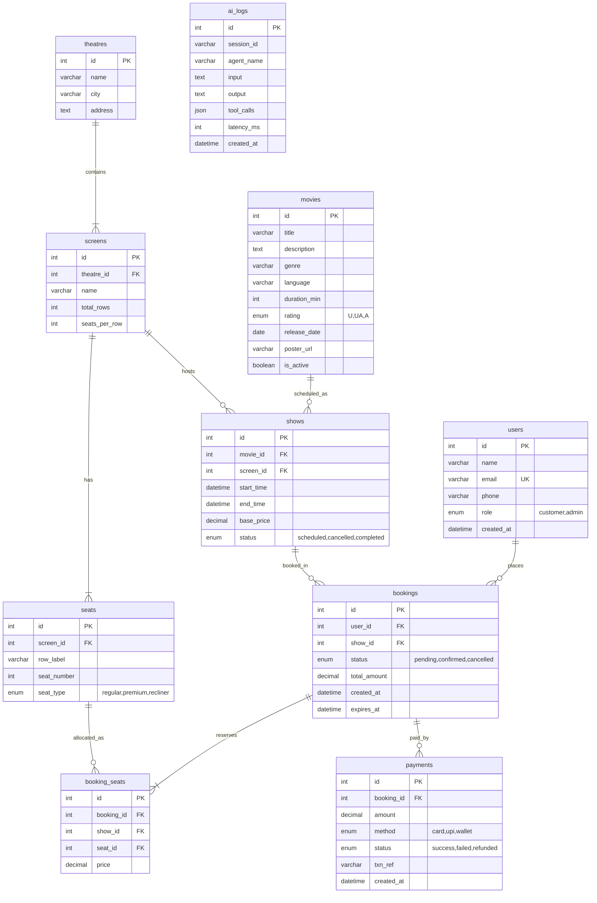
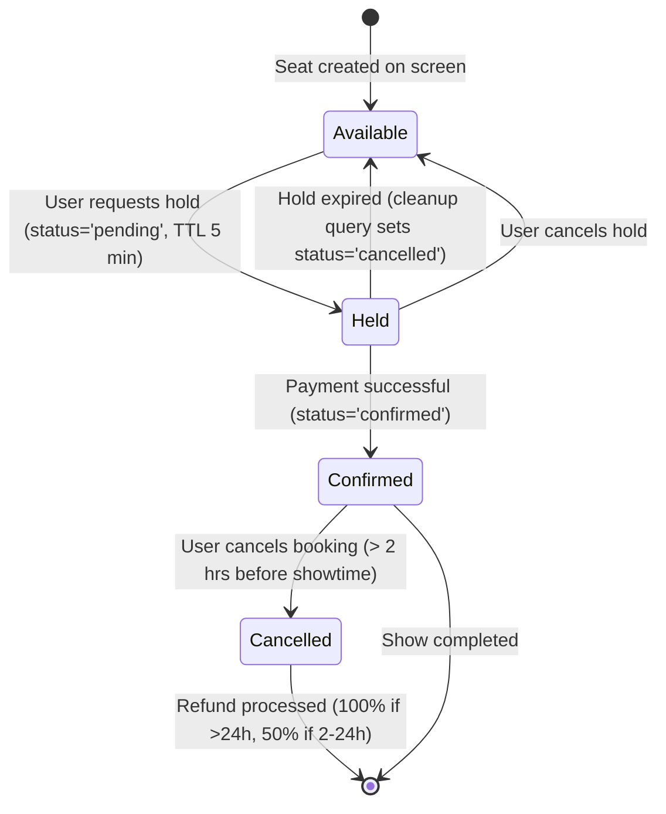
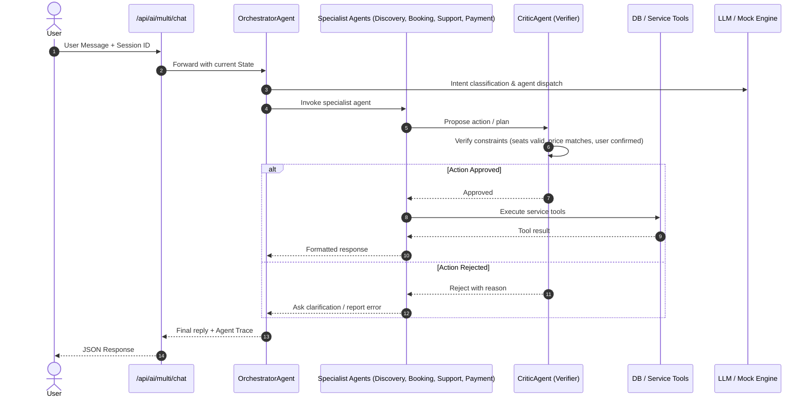

# System Architecture

## Component Overview
```mermaid
graph TD
    Client[Browser / Vanilla JS Frontend] -->|HTTP / JSON| API[FastAPI Application]
    
    subgraph FastAPI Application
        Routers[Routers: Movies, Theatres, Shows, Bookings, AI]
        Errors[Errors & Standard Exception Handlers]
        Auth[Demo User Context Header]
    end
    
    subgraph Business Services
        BookingService[Booking Service: Seat Hold, Release, Confirm]
        PricingEngine[Pricing Engine: Tiers, Surcharges, Fees]
        Seeder[Seed Service]
    end

    subgraph AI Layer
        LLMClient[LLM Client: OpenAI API / Deterministic Mock]
        Guardrails[Guardrails & Security Filters]
        GenAIFeatures[GenAI Features: Summary, Recommender, Reviews]
        SingleAgent[Single Agent ReAct Loop: Tools + DB Engine]
        MultiAgent[Multi-Agent Orchestrator: Discovery, Booking, Payment, Support, Critic]
    end

    subgraph Database Layer
        MySQL[(MySQL 8 Database / PyMySQL)]
        SQLiteTest[(SQLite In-Memory / pytest)]
    end

    API --> Business Services
    API --> AI Layer
    Business Services --> MySQL
    Business Services --> SQLiteTest
    AI Layer --> Business Services
    AI Layer --> LLMClient
```

## Entity Relationship (ER) Diagram


## Booking Lifecycle & State Transitions


## AI Orchestration Flow

